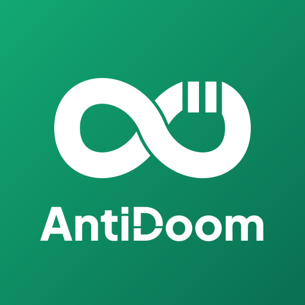

# 🛡️ AntiDoom

<p align="center">
  
</p>

<p align="center">
  <strong>Reclaim Your Time. Break the Loop.</strong><br>
  <em>(Kendalikan Waktumu. Putuskan Lingkaran Scroll.)</em>
</p>

<p align="center">
  <a href="LICENSE"></a>
  
  
  
  
</p>

---

## 🌟 Tentang AntiDoom

**AntiDoom** adalah aplikasi *open-source*, *privacy-first*, dan *offline-ready* untuk Android yang dirancang khusus untuk memutus kebiasaan *doomscrolling* (Reels, TikTok, YouTube Shorts, X/Twitter). 

Berbeda dengan aplikasi komersial yang berbayar dan tertutup (*closed-source*), AntiDoom memproses seluruh data langsung di perangkat Anda tanpa server eksternal, tanpa analitik pelacak, dan 100% transparan.

Selain memberikan intervensi jeda, AntiDoom juga memiliki fitur **Floating Scrolling Counter Overlay** yang menempel secara elegan di atas aplikasi feed untuk memberi Anda kesadaran (*mindfulness*) langsung berapa kali Anda telah menggeser layar.

---

## ✨ Fitur Utama (MVP)

1. **⚡ Floating Scrolling Counter (Overlay di Atas)**:
   - Gelembung mini melayang (*floating pill*) yang dapat digeser (*draggable*) di atas aplikasi media sosial.
   - Menghitung jumlah swipe/scroll secara langsung secara *real-time* (`⚡ 42 scrolls • Instagram`).
2. **🛡️ The Interceptor (Full-screen Zen Blocker)**:
   - Muncul secara halus saat batas scrolling atau durasi tercapai (contoh: 50x swipe atau 15 menit).
   - Menampilkan afirmasi menenangkan: *"Udah cukup ya, mata lu butuh istirahat. Tarik napas dulu."*
   - Dilengkapi tombol cepat: **Tutup Aplikasi (Kembali ke Home)** atau **Jeda 5 Menit (Snooze)**.
3. **📊 Daily Dashboard & Analytics**:
   - Total scrolling terpantau hari ini, estimasi waktu yang berhasil diselamatkan, serta frekuensi intervensi.
   - Grafik distribusi penggunaan per aplikasi dan histori 7 hari.
4. **⚙️ Customizable Rules**:
   - Atur batas scroll (*swipes threshold*) dan batas durasi per target aplikasi (Instagram, TikTok, YouTube Shorts, X/Twitter, Facebook).
5. **🔒 100% Privacy-First & Offline**:
   - Tidak pernah membaca konten postingan, DM/chat, atau input teks.
   - Hanya menghitung event scroll dan nama package target aplikasi.

---

## 🏗️ Arsitektur Sistem

```text
[ Android OS ]
      │
      ├──> [ Accessibility Service ] (Kotlin) ──> Deteksi App Aktif & Scroll Event
      │
      ├──> [ Foreground Service ] (Kotlin) ────> Menjaga service tetap aktif di latar belakang
      │
      └──> [ Window Manager ] (Kotlin) ────────> Floating Counter & Zen Interceptor Overlay
                │
                ▼
[ Flutter Engine ] <──(MethodChannel: com.antidoom/native)──> [ Native Bridge ]
      │
      ├──> [ UI Dashboard & Settings ] (Flutter Widgets + Google Fonts)
      └──> [ State Management ] (Riverpod) & Local Storage
```

---

## 📱 Izin Sistem Android (Permissions)

AntiDoom membutuhkan izin tingkat sistem berikut yang dipandu langsung melalui layar Onboarding:

| Izin | Kegunaan |
| :--- | :--- |
| **`BIND_ACCESSIBILITY_SERVICE`** | Mendeteksi package aplikasi feed dan pergerakan scroll. |
| **`SYSTEM_ALERT_WINDOW`** | Menampilkan *floating counter pill* dan full-screen interceptor di atas aplikasi lain. |
| **`FOREGROUND_SERVICE` & `SPECIAL_USE`** | Memastikan pemantau tidak dimatikan paksa oleh sistem Android 14+. |
| **`REQUEST_IGNORE_BATTERY_OPTIMIZATIONS`** | Menghindari *aggressive task killer* OEM (Xiaomi, Oppo, Vivo, Samsung). |

---

## 📁 Struktur Direktori

```text
antidoom/
├── android/
│   └── app/src/main/
│       ├── kotlin/com/antidoom/
│       │   ├── MainActivity.kt               # MethodChannel Handler & Bridge
│       │   ├── services/
│       │   │   ├── AntiDoomAccessibilityService.kt # Pelacak scroll & package
│       │   │   ├── AntiDoomForegroundService.kt    # Service persisten background
│       │   │   └── OverlayService.kt               # Floating counter & interceptor
│       │   └── utils/
│       │       └── PermissionHelper.kt       # Pengecekan & pembuka izin sistem
│       └── AndroidManifest.xml
├── lib/
│   ├── main.dart                             # Entry point Flutter
│   ├── core/
│   │   ├── theme/                            # Design system (Zen Green, Dark AMOLED)
│   │   └── constants/                        # Konstanta & target aplikasi
│   ├── data/
│   │   ├── models/                           # AppRule & ScrollStat
│   │   └── repositories/                     # Penyimpanan lokal (Preferences)
│   ├── presentation/
│   │   ├── providers/                        # Riverpod Notifier & State
│   │   ├── onboarding/                       # Panduan aktivasi izin sistem
│   │   ├── dashboard/                        # Layar utama dashboard & floating widget
│   │   ├── settings/                         # Konfigurasi batas scroll per aplikasi
│   │   └── overlay_preview/                  # Dialog preview & simulasi intervensi
│   └── services/
│       └── native_bridge.dart                # MethodChannel Wrapper Dart
├── assets/
│   └── images/                               # Logo, splash mark, dan aset grafis
└── pubspec.yaml
```

---

## 🚀 Menjalankan Project

### Prasyarat
- Flutter SDK 3.x+ (Dart 3.x+)
- Android SDK (Target API 34+ / Android 14)
- Android Device fisik atau Emulator dengan Google Play Services

### Langkah Instalasi
```bash
# Clone repository
git clone https://github.com/your-username/antidoom.git
cd antidoom

# Install dependencies
flutter pub get

# Jalankan analyzer & test
flutter analyze
flutter test

# Jalankan ke device
flutter run
```

---

## 🎨 Design System & Branding

- **Tema Utama**: Dark AMOLED (`#121212`) untuk mengurangi kelelahan mata.
- **Warna Aksen**: Zen Green (`#27AE60`), Soft Amber (`#F39C12`), Coral Red (`#E74C3C`).
- **Tipografi**: Plus Jakarta Sans / Inter via Google Fonts.
- **Logo & Ikon**: Tersedia dalam berbagai format di `antidoom-logo/` dan `assets/images/`.

---

## 📜 Lisensi & Kontribusi

Project ini dirilis di bawah lisensi open-source **MIT**. Kontribusi berupa saran, pelaporan bug, dan Pull Request sangat kami sambut!
