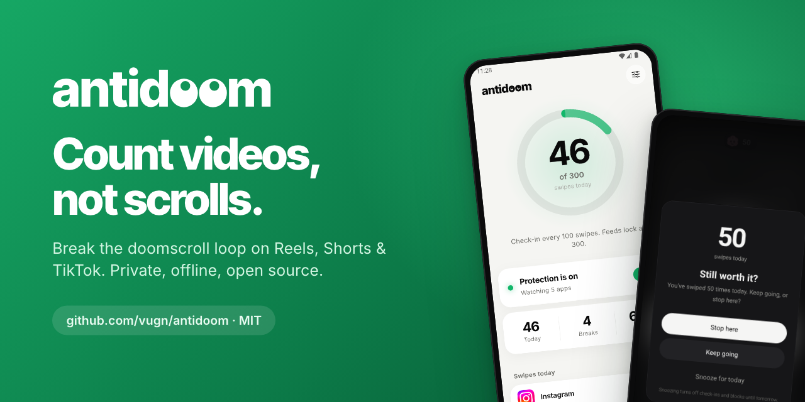
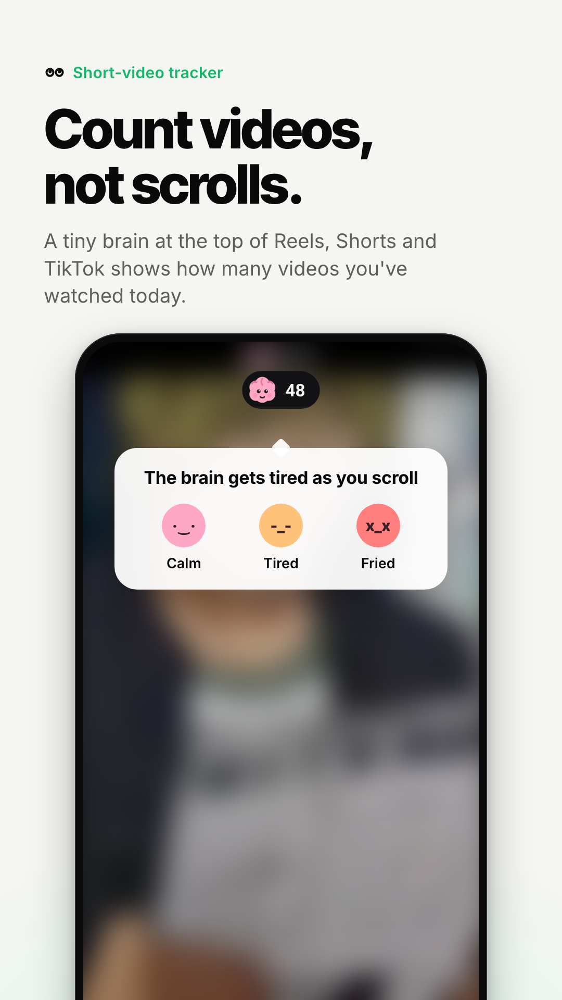
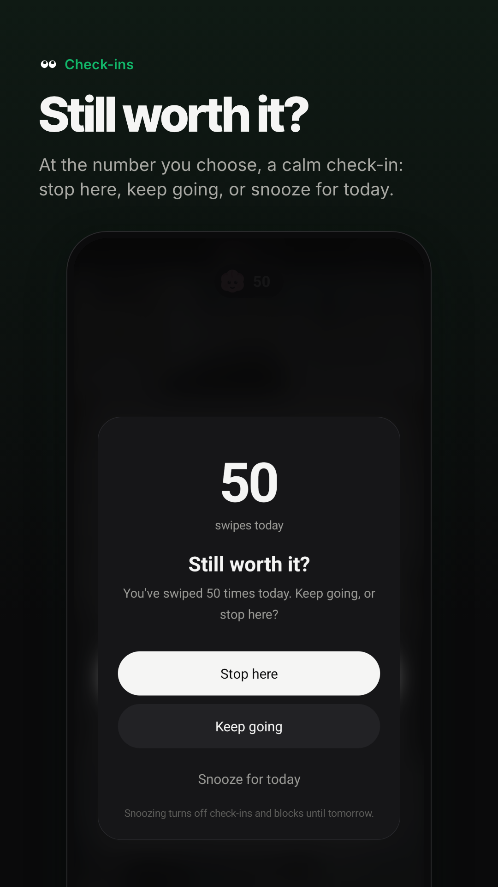
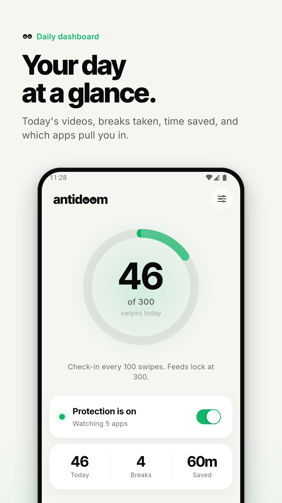
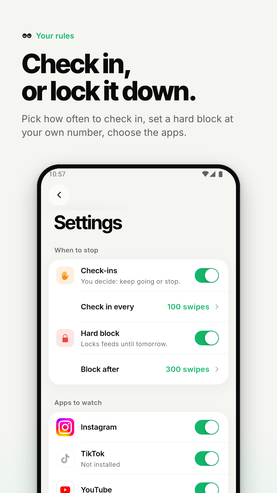
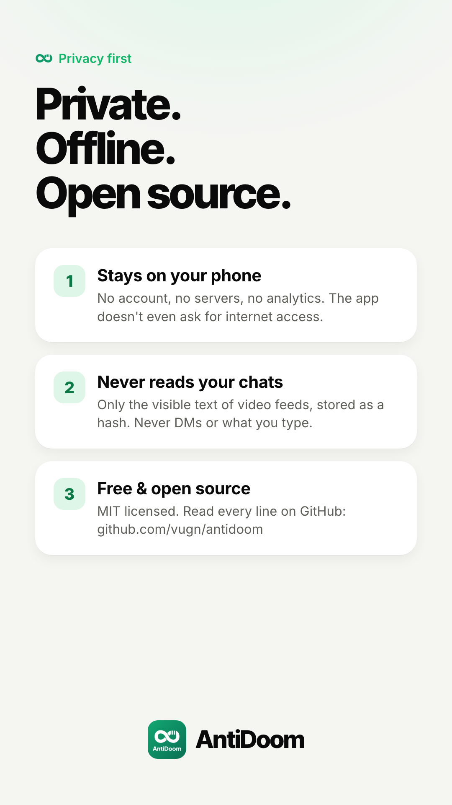

<p align="center">
  
</p>

<h1 align="center">AntiDoom</h1>

<p align="center">
  <strong>Reclaim Your Time. Break the Loop.</strong>
</p>

<p align="center">
  <a href="LICENSE"></a>
  
  
  
  
</p>

---

## 🌟 About AntiDoom

**AntiDoom** is an *open-source*, *privacy-first*, *offline* Android app built to break the *doomscrolling* habit in short-video feeds: Instagram Reels, TikTok, YouTube Shorts, Facebook Reels and X/Twitter.

Unlike paid, closed-source alternatives, AntiDoom processes everything on your device. It has no servers and no tracking analytics, and all of its code is public.

Besides stepping in with breaks, AntiDoom shows a **floating counter** on top of the feed, so you always know how many videos you've watched today.

---

## 📸 Screenshots

<p align="center">
  
  
  
  
  
</p>

Store-ready graphics live in [`docs/store/`](docs/store): five 1080×1920 phone screenshots and a 1024×500 Play Store feature graphic. Third-party video content in the screenshots is blurred.

---

## 🌐 Website

The website lives in its own repository: **[vugn/antidoom-web](https://github.com/vugn/antidoom-web)** → **<https://antidoom.app>**

It is a dependency-free static site (HTML/CSS/JS, no build step), multilingual (`/en/` and `/id/`) with a home page, a how-it-works page, the privacy policy and an about page. Deploy on push to `main` via GitHub Pages. Screenshot and brand assets used by the site are copied from `docs/store/` and `brand/` in this repo.

---

## ✨ Features

1. **🧠 Counts videos, not scroll events**:
   - AntiDoom recognises *which video* is on screen from a fingerprint of the creator name and caption, and counts **distinct videos**.
   - Swipes that bounce back, comment scrolling and quick flicks past a video (< 750 ms) are not counted. Scrolling back to a video you already saw doesn't count it again.
   - Full details: [docs/tracking.md](docs/tracking.md).
2. **⚡ Floating counter**:
   - A small draggable pill at the top centre of the screen, with a brain whose expression changes with today's count (calm → tired → fried).
3. **🛡️ Check-ins & hard block**:
   - **Check-in** every N videos (default 100): keep going, stop, or *snooze* until tomorrow.
   - Optional **hard block** at a number you type in yourself: feeds stay locked until tomorrow.
4. **📊 Daily dashboard**: today's total, number of breaks, and a per-app breakdown.
5. **🚀 Onboarding**: language (EN/ID) → apps to watch → check-in or block mode → permissions.
6. **🔒 Privacy-first & offline**:
   - Everything runs on the phone: no servers, no analytics, and the release build doesn't even request internet access.
   - Visible text in video feeds (creator name and caption) is read only to build the fingerprint. Only a **hash** is stored, never the text. DMs, chats and typed text are never read.

---

## 🏗️ Architecture

```text
[ Android OS ]
      │
      ├──> [ Accessibility Service ] (Kotlin) ──> Feed detection & video fingerprints (ReelDetector)
      │
      ├──> [ Accessibility Overlay ] (Kotlin) ──> Floating counter & check-in / block screen
      │
      ├──> [ Foreground Service ] (Kotlin) ────> Keeps tracking alive in the background
      │
      └──> [ TrackerPrefs ] (Kotlin) ──────────> Daily counts & config (source of truth)
                │
                ▼
[ Flutter Engine ] <──(MethodChannel: com.antidoom/native)──> [ Native Bridge ]
      │
      ├──> [ Dashboard, Settings & Onboarding UI ] (Flutter widgets)
      └──> [ State Management ] (Riverpod) & local storage
```

---

## 📱 Android Permissions

AntiDoom only asks for what it needs. The onboarding screens walk you through accessibility and battery; there is no "display over other apps" or usage-access permission, because the overlays are drawn by the accessibility service.

| Permission | Purpose |
| :--- | :--- |
| **`BIND_ACCESSIBILITY_SERVICE`** | Detects short-video feeds, reads visible text for video fingerprints, and draws the overlays. |
| **`FOREGROUND_SERVICE` & `SPECIAL_USE`** | Keeps the tracker from being killed by Android 14+. |
| **`POST_NOTIFICATIONS`** | Shows the ongoing notification for the foreground service. |
| **`REQUEST_IGNORE_BATTERY_OPTIMIZATIONS`** | Avoids aggressive OEM task killers (Xiaomi, Oppo, Vivo, Samsung). |

---

## 📁 Project Structure

```text
antidoom/
├── android/
│   └── app/src/main/
│       ├── kotlin/com/antidoom/
│       │   ├── MainActivity.kt                     # MethodChannel handler & bridge
│       │   ├── services/
│       │   │   ├── AntiDoomAccessibilityService.kt # Screen-read scheduling, counting rules, check-in/block
│       │   │   ├── ReelDetector.kt                 # Per-app video fingerprints
│       │   │   ├── AntiDoomForegroundService.kt    # Persistent background service
│       │   │   ├── OverlayService.kt               # Floating counter & check-in/block screen
│       │   │   └── BrainView.kt                    # Brain drawing in the floating counter
│       │   └── utils/
│       │       ├── TrackerPrefs.kt                 # Config, daily stats, video history (hashed)
│       │       └── PermissionHelper.kt             # System permission checks & shortcuts
│       └── AndroidManifest.xml
├── lib/
│   ├── main.dart                                   # Flutter entry point
│   ├── core/
│   │   ├── theme/                                  # Palette & typography (light/dark)
│   │   ├── localization/                           # English & Indonesian copy
│   │   └── constants/                              # Constants, supported apps, links
│   ├── data/
│   │   ├── models/                                 # Data models
│   │   └── repositories/                           # Local storage (preferences)
│   ├── presentation/
│   │   ├── providers/                              # Riverpod notifiers & state
│   │   ├── onboarding/                             # First-run setup & permissions
│   │   ├── dashboard/                              # Home screen
│   │   ├── settings/                               # Limits, apps, language, about
│   │   ├── widgets/                                # Shared UI components
│   │   └── overlay_preview/                        # Break-screen preview
│   └── services/
│       └── native_bridge.dart                      # Dart MethodChannel wrapper
├── brand/                                          # Logo kit: SVG masters, PNGs, guidelines, generator
├── assets/
│   ├── brand/                                      # Logo SVGs used in the app
│   ├── images/apps/                                # Social app logos
│   └── fonts/                                      # Inter & Inter Tight (OFL 1.1)
├── docs/
│   ├── tracking.md                                 # How AntiDoom counts videos
│   ├── images/banner.png                           # README banner
│   └── store/                                      # Store screenshots & feature graphic
├── LICENSE                                         # GPL-3.0
└── pubspec.yaml
```

---

## 🚀 Getting Started

### Requirements
- Flutter SDK 3.x+ (Dart 3.x+)
- Android SDK (target API 34+ / Android 14)
- A physical Android device or an emulator with Google Play Services

### Setup
```bash
# Clone the repository
git clone https://github.com/vugn/antidoom.git
cd antidoom

# Install dependencies
flutter pub get

# Run the analyzer & tests
flutter analyze
flutter test

# Run on a device (pick a flavor, see below)
flutter run --flavor foss
```

To reset onboarding on a device: `adb shell pm clear com.antidoom`.

### Two flavors: `foss` and `play`

One codebase, two builds. Every `flutter run` / `flutter build` needs `--flavor`.

| | `foss` | `play` |
| :--- | :--- | :--- |
| Ships on | GitHub Releases (and F-Droid later) | Google Play |
| Ads | None | One AdMob banner at the bottom of the dashboard, never in the counter or a check-in |
| Purchases | None | One-time "Remove ads" (`remove_ads`, non-consumable) |
| Internet permission | None (stripped in `android/app/src/foss/AndroidManifest.xml`) | Yes, for ads and billing |

Contributors only need `foss`; no AdMob or Play Console account is involved. The code lives behind
`lib/services/monetization/` (`NoopMonetization` for foss, `PlayMonetization` for play).

The `play` flavor uses Google's public **test** ad IDs unless real ones are supplied:
`android/admob.properties` (gitignored) with `admobAppId=ca-app-pub-…~…`, and
`--dart-define=ADMOB_BANNER_ID=ca-app-pub-…/…` at build time. The `Play bundle` workflow reads both
from the `ADMOB_APP_ID` and `ADMOB_BANNER_ID` repository secrets and refuses to build without them.

---

## 🎨 Design & Branding

- **Theme**: neutral, high-contrast palette with a single green accent. Light and dark mode follow the system setting.
- **Typography**: Inter (text) and Inter Tight (numbers & titles), bundled in `assets/fonts/` under the SIL Open Font License 1.1. Nothing is downloaded at runtime, so the release build needs no internet permission.
- **Glass effects**: [`liquid_glass_easy`](https://pub.dev/packages/liquid_glass_easy) for pinned controls.
- **Logo ("Look Up")**: the *oo* in *doom* are eyes glancing up. The opposite of doomscrolling is looking up. Every logo file, the colours and the usage rules are in [`brand/`](brand/README.md); `brand/source/build_brand.py` generates the logo files and every Android icon from one source.

---

## 📜 License & Contributing

**AntiDoom** is made by [vugn](https://github.com/vugn). Source code: <https://github.com/vugn/antidoom>

Released under the **[GNU GPL v3](LICENSE)**, with an [additional permission](LICENSE-EXCEPTION.md) that lets the Google Play build link Google's ads and billing libraries. © 2026 vugn.

The name "AntiDoom", the logo and the brand files are not covered by the code license; see [TRADEMARK.md](TRADEMARK.md). Forks are welcome under their own name and icon.

Bundled fonts: [Inter](https://github.com/rsms/inter) and [Inter Tight](https://github.com/rsms/inter-tight) by The Inter Project Authors, licensed under the [SIL Open Font License 1.1](assets/fonts/inter/OFL.txt).

Suggestions, bug reports and pull requests are welcome. If an app's count is off, please attach the `adb logcat -s AntiDoomDetect` output from a debug build (see [docs/tracking.md](docs/tracking.md#debugging)).
