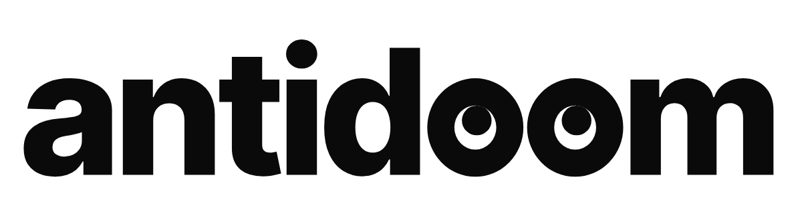

# AntiDoom brand: "Look Up"

<p align="center"></p>

**Idea:** the *oo* in *doom* are a pair of eyes glancing up. The opposite of doomscrolling is looking up.

The letters are Inter Tight ExtraBold, converted to outlines. The eyes are custom: an ink ring with the pupil pushed to the top
(slightly right), so the white of the eye shows *below* the pupil.

---

## Files

| File | Use |
| :--- | :--- |
| `svg/antidoom-wordmark.svg` | Primary logo on light backgrounds |
| `svg/antidoom-wordmark-white.svg` | On dark or photo backgrounds (solid white eyes, the pupils are holes) |
| `svg/antidoom-wordmark-green.svg` | One-colour green, for light backgrounds |
| `svg/antidoom-symbol.svg` | The eyes alone, on light backgrounds |
| `svg/antidoom-symbol-white.svg` | The eyes alone, on dark or green backgrounds |
| `svg/antidoom-icon.svg` / `-round` / `-dark` | App icon: white eyes on a green (or black) tile |
| `svg/antidoom-mood-calm/tired/fried.svg` | Expressions, for the counter and illustrations |
| `png/` | PNG exports, including the 512 px Play Store icon |

All of these files, plus the Android launcher, themed, notification and splash icons, are generated by
`source/build_brand.py`. Change the geometry there and rerun it from the repo root:

```bash
python3 brand/source/build_brand.py     # needs Google Chrome for the PNG exports
```

## Colours

| Name | HEX | Use |
| :--- | :--- | :--- |
| Ink | `#0A0A0A` | Wordmark, rings, pupils |
| Green | `#12B76A` | App icon tile, accents |
| Paper | `#F5F5F2` | Light background |
| Night | `#0A0A0B` | Dark background |
| White | `#FFFFFF` | Eyes on dark/green |

## Rules

- **Clear space:** keep at least the width of one eye (one *o*) free around the wordmark.
- **Minimum size:** wordmark 72 px wide on screen (14 mm in print). Symbol 16 px. Below 16 px use the app icon.
- **Backgrounds:** use the line versions (`antidoom-wordmark.svg`, `antidoom-symbol.svg`) on light backgrounds. Use the
  `-white` versions on dark backgrounds, green, or photos.
- **The eyes always look up.** Don't make them look down, sideways, or cross-eyed. The `tired` and `fried` moods are
  only for the in-app counter and illustrations, never for the logo itself.
- **Don't:** retype the name in another font, stretch or rotate the logo, add outlines, shadows or gradients, put
  the line version on a dark background, or recolour the eyes separately from the letters.

## Credits

Inter Tight by The Inter Project Authors, licensed under the SIL Open Font License 1.1 (see
`assets/fonts/intertight/OFL.txt`). Using the outlined letters in a logo is allowed under the OFL.
